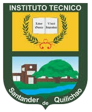
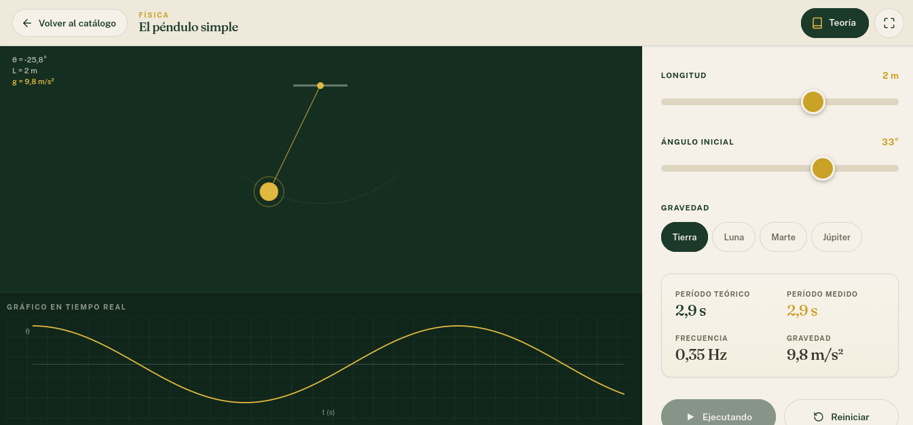
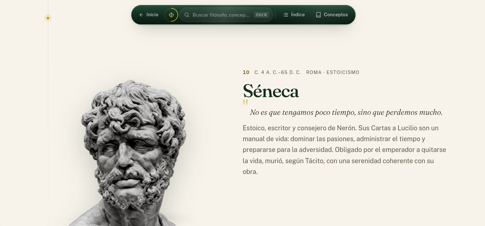
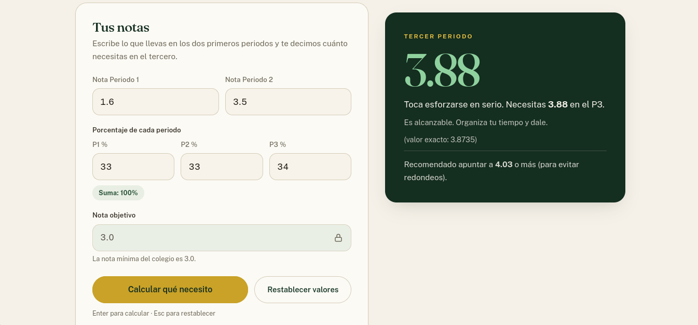

<div align="center">



# Instituto Técnico · Sitio Web

### Rediseño completo del sitio institucional del Instituto Técnico de Santander de Quilichao, Cauca 🇨🇴

*Una institución pública que forma técnicos y ciudadanos desde 1913.*

<br>

[](URL_DE_TU_DEMO)
[](https://github.com/ryderx7/Instecnico-web/issues)
[](https://github.com/ryderx7/Instecnico-web/stargazers)


<br>


</div>

---

## 📑 Contenido

[Sobre el proyecto](#-sobre-el-proyecto) ·
[Lo más destacado](#-lo-más-destacado) ·
[Yumi, el motor](#-yumi-el-motor-del-sitio) ·
[Calidad del sitio](#-calidad-del-sitio) ·
[Estructura](#-estructura-del-proyecto) ·
[Instalación](#-correrlo-en-local) ·
[Noticias (CMS)](#-gestionar-noticias) ·
[Hoja de ruta](#-hoja-de-ruta) ·
[Créditos](#-créditos)

---

## 🎓 Sobre el proyecto

El **Instituto Técnico** nació el 3 de abril de 1913, por iniciativa del diputado Marcial Lemus Nates. Hoy cuenta con **4 sedes**, más de **3.300 estudiantes** y más de **113 años** de historia en Santander de Quilichao.

Este repositorio es un **rediseño total de su sitio web**: más claro, más rápido y pensado para el celular. Además de informar, ofrece herramientas para toda la comunidad educativa: un laboratorio virtual, una calculadora de notas y un capítulo interactivo de Filosofía.

> 💡 Construido con **HTML, CSS y JavaScript puro**: sin frameworks, sin npm y sin paso de compilación. Cada página carga rápido incluso con conexiones limitadas, gracias a [Yumi](#-yumi-el-motor-del-sitio), el motor propio del proyecto.

---

## ✨ Lo más destacado

<table>
  <tr>
    <td width="33%" align="center">
      <br>
      <b>🧪 Laboratorio virtual</b><br><sub>8 experimentos interactivos de física y química</sub>
    </td>
    <td width="33%" align="center">
      <br>
      <b>🧠 Filosofía interactiva</b><br><sub>17 pensadores, periodos y conceptos clave</sub>
    </td>
    <td width="33%" align="center">
      <br>
      <b>📐 Calculadora de notas</b><br><sub>Cuánto necesitas en el P3 para aprobar</sub>
    </td>
  </tr>
</table>

| Página | Qué ofrece |
|---|---|
| 🏠 [`index.html`](index.html) | Hero con video adaptable, datos institucionales, sedes, noticias, contacto y mapa |
| 📜 [`historia.html`](historia.html) | Línea de tiempo desde 1913, símbolos institucionales y egresados destacados |
| 🧪 [`laboratorio-virtual.html`](laboratorio-virtual.html) | 8 experimentos con teoría incluida: entalpía, valoración ácido-base, Ley de Ohm, Ley de Hooke, péndulo, presión hidrostática, ondas estacionarias y densidad |
| 📐 [`calculadora.html`](calculadora.html) | Escala 0.0–5.0 (aprueba con 3.0): nota definitiva o nota necesaria en el tercer periodo |
| 🧠 [`filosofia.html`](filosofia.html) | Capítulo interactivo con audio de introducción, 17 pensadores y biblioteca de conceptos |
| 🖼️ [`galeria.html`](galeria.html) | Galería fotográfica con filtros por categoría |
| 🎮 [`404.html`](404.html) | Página de error con minijuego propio: sprites, power-ups y enemigos |

---

## 🌀 Yumi, el motor del sitio

**Yumi** es un motor ligero de ejecución en el navegador, escrito a medida para este proyecto. Funciona como una capa común bajo todas las páginas y se ocupa de tres frentes: **fluidez**, **adaptación al dispositivo** y **defensa web**.

> 📦 `assets/js/yumi.js` · **v2.1.0** · sin dependencias · compatible con navegadores antiguos (degrada con elegancia si faltan `WeakMap`, `Set` o `IntersectionObserver`)

### Qué resuelve

| Módulo | Responsabilidad |
|---|---|
| 🛡️ **`Yumi.security`** | Sanitización con lista blanca (`safeHTML`, `sanitizeNode`), inserción segura de texto (`safeText`), validación de URLs (`safeURL`, solo `http`, `https`, `mailto` y `tel`), política **Trusted Types**, endurecimiento automático de `iframes` (sandbox, carga diferida y referrer) y de formularios, y un observador del DOM (`watchDOM`) que neutraliza atributos y nodos peligrosos insertados en caliente |
| ⚡ **`Yumi.perf`** | Planificador por frames que se pausa con la pestaña oculta (`raf`), tareas en reposo (`idle`), revelado de elementos con un único `IntersectionObserver` compartido, listeners pasivos, y `preconnect` / `prefetch` que respetan el ahorro de datos |
| 📱 **Adaptación** | Detecta móvil (≤ 860 px), `prefers-reduced-motion`, ahorro de datos, conexión 2G y dispositivos de gama baja (poca RAM o CPU), y lo expone como clases en `<html>`: `yumi-mobile`, `yumi-reduce` y `yumi-lite` |
| ♿ **`Yumi.ui`** | Bloqueo de scroll que conserva posición y estilos previos (`lock` / `unlock`), y trampas de foco apilables para modales y menús (`focusTrap` / `restoreFocus`) |
| 💾 **`Yumi.storage`** | Envoltorio de `localStorage` y `sessionStorage` que nunca lanza errores: serializa JSON, admite **TTL**, usa un respaldo en memoria si el almacenamiento falla o está lleno, y limpia entradas caducadas ante una cuota excedida |
| 🔄 **`Yumi.lifecycle`** | Registro de limpiezas (`onCleanup`, `clean`, `cleanAll`) y `dispose()` idempotente que libera observadores, listeners, scroll lock y trampas de foco al salir de la página |

### Principios de diseño

- **A prueba de fallos:** cada paso de arranque se ejecuta aislado; si uno falla, el resto sigue funcionando.
- **API inmutable:** la fachada pública y sus espacios de nombres se congelan con `Object.freeze`, y el estado interno nunca se expone.
- **Idempotente:** puede cargarse o inicializarse varias veces sin duplicar observadores ni listeners.
- **Respetuoso con el usuario:** reduce animaciones, evita precargas y ahorra datos cuando el dispositivo o la conexión lo piden.
- **Depurable:** añade `?debug=1` a cualquier URL para ver los registros del motor en consola.

### Uso rápido

```html
<script src="assets/js/yumi.js"></script>
<script>
  Yumi.readyThen(function (y) {
    // Insertar HTML de terceros sin riesgo
    y.security.safeHTML(document.querySelector('#noticia'), htmlExterno);

    // Guardar una preferencia durante 24 h
    y.storage.set('tema', 'oscuro', { ttl: 24 * 60 * 60 * 1000 });

    // Trabajo no urgente, fuera del camino crítico
    y.perf.idle(function () { /* ... */ });

    // Adaptar la experiencia al dispositivo
    if (y.lowEnd()) { /* versión ligera */ }
  });
</script>
```

---

## 🧱 Calidad del sitio

| | |
|---|---|
| ⚡ **Rendimiento** | Video del hero con `preload="none"` y póster; cambia a imagen en conexiones lentas o con ahorro de datos; *skeleton loaders* en las noticias |
| ♿ **Accesibilidad** | Enlace "Saltar al contenido", navegación completa por teclado, `aria-label` en controles, objetivos táctiles de 44 px y botón para pausar el video |
| 🔒 **Seguridad** | Content Security Policy en cada página, enlaces externos con `noopener noreferrer`, noticias escapadas antes de mostrarse y banner de cookies con política de privacidad |
| 🔍 **SEO** | Open Graph, Twitter Cards, datos estructurados JSON-LD (`EducationalOrganization`, `FAQPage`), enlaces canónicos y `noindex` en la 404 |

| Capa | Tecnología |
|---|---|
| Estructura | HTML5 semántico |
| Estilos | CSS3: Grid, Flexbox, variables CSS, `clamp()` |
| Lógica | JavaScript vanilla + motor [Yumi](#-yumi-el-motor-del-sitio) |
| Contenido | `content/noticias.json`, editable desde el CMS |
| Panel admin | Netlify Identity + Netlify CMS en `/admin` |
| Tipografías | [Fraunces](https://fonts.google.com/specimen/Fraunces) (títulos) y [Public Sans](https://fonts.google.com/specimen/Public+Sans) (texto) |

**Identidad visual:** hueso `#F5F1E8` · verde oscuro `#1B3A2A` · verde profundo `#142E20` · dorado `#C9A227` · dorado claro `#DFB93F`

---

## 📂 Estructura del proyecto

```
Instecnico-web/
│
├── index.html                  Inicio
├── historia.html               Historia institucional
├── filosofia.html              Capítulo interactivo de Filosofía
├── laboratorio-virtual.html    8 experimentos interactivos
├── calculadora.html            Calculadora de notas
├── galeria.html                Galería fotográfica
├── 404.html                    Error con minijuego
│
├── admin/                      Panel de administración (Netlify CMS)
│   ├── index.html
│   └── config.yml
│
├── content/
│   └── noticias.json           Noticias del inicio
│
└── assets/
    ├── js/
    │   ├── yumi.js             ⭐ Motor Yumi
    │   ├── calculadora.js
    │   ├── filosofia.js
    │   └── identity-redirect.js
    ├── css/                    calculadora.css · filosofia.css
    ├── images/
    │   ├── screenshots/        📸 Capturas de este README
    │   ├── filosofos/          17 retratos
    │   ├── game/               Sprites del minijuego 404
    │   └── …                   logo, bandera, sedes, galería, historia, noticias
    ├── audio/                  Himno institucional · intro de Filosofía
    ├── icons/                  himno.svg · lema.svg
    ├── videos/                 hero.webm
    └── noticias/               Imágenes subidas desde el CMS
```

---

## 🚀 Correrlo en local

No requiere instalación ni compilación.

```bash
git clone https://github.com/ryderx7/Instecnico-web.git
cd Instecnico-web

npx serve .
# o
python -m http.server 8000
```

> ⚠️ Usa un servidor local; no abras `index.html` con doble clic. Las noticias se cargan con `fetch()`, que los navegadores bloquean en `file://`.

---

## 📰 Gestionar noticias

Las noticias del inicio viven en `content/noticias.json` y se editan de dos formas:

1. **Desde el panel:** entra a `/admin`, inicia sesión con Netlify Identity y publica sin tocar código.
2. **A mano:** edita el archivo respetando esta estructura:

```json
{
  "items": [
    {
      "title": "Título de la noticia",
      "date": "2026-01-15",
      "author": "Instituto Técnico",
      "category": "Noticia",
      "image": "assets/images/mi-imagen.jpg",
      "body": "Texto de la noticia en Markdown."
    }
  ]
}
```

---

## 🗺️ Hoja de ruta

- [ ] Publicar la demo en vivo y enlazarla arriba
- [ ] Lighthouse 95+ en las cuatro categorías
- [ ] Más experimentos en el laboratorio virtual
- [ ] Más capítulos interactivos, como el de Filosofía, para otras áreas
- [ ] Versión en inglés
- [ ] Modo claro / oscuro seleccionable

Ideas y sugerencias son bienvenidas en [Issues](https://github.com/ryderx7/Instecnico-web/issues).

---

## 🤝 Créditos

- **Diseño, desarrollo y motor Yumi:** [ryderx7](https://github.com/ryderx7)
- **Metodología de Filosofía:** profesor Gersaín León Franco
- **Institución:** I.E. Instituto Técnico, Santander de Quilichao, Cauca, Colombia
- Tipografías de [Google Fonts](https://fonts.google.com)

Los escudos, logos, himno y fotografías institucionales pertenecen al Instituto Técnico.

---

<div align="center">

Hecho con 💚 y 💛 para el Instituto Técnico · desde 1913

⭐ Si te gustó el proyecto, déjale una estrella al repo

</div>
